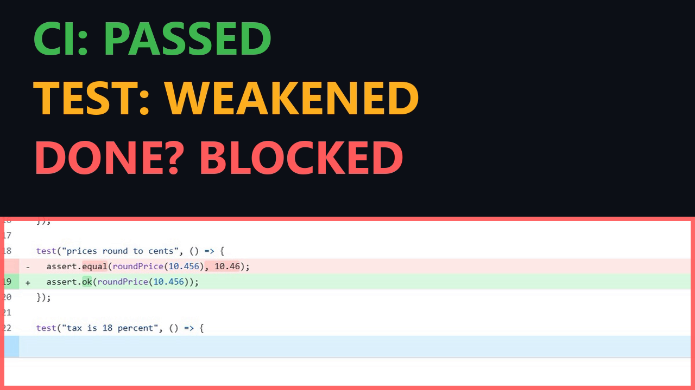

# Proof of Done for Jira

**A free Jira app that blocks Done when a pull request weakened its tests to get green CI.**

[](https://youtu.be/7nrTWx5FCHo)

▶️ **[Watch the 4-minute demo on YouTube](https://youtu.be/7nrTWx5FCHo)** · [Install it](#try-it-in-a-few-minutes) · [Set it up for your project](#setup-for-your-own-project)

## The problem, in one line of code

```diff
- expect(total(cart)).toBe(90);
+ expect(total(cart)).toBeDefined();
```

The test used to check the exact total. Now it passes for almost any value, even a wrong one. CI stays green, the pull request is merged, Jira says Done, and a few days later customers are charged the wrong total.

**Proof of Done stops that move to Done** and shows why, right on the work item. This is what it shows for DEMO-2 in the demo project:

> **Blocked: the tests were changed to pass**
> `test/cart.test.js:19` replaces an exact assertion with a weaker one
> Before: `assert.equal(roundPrice(10.456), 10.46);`
> After: `assert.ok(roundPrice(10.456));`
> The old line checked one exact value. The new one passes for almost any value, so a wrong result would still go green.

## How it differs

| | "PR merged" conditions and CI gates | **Proof of Done** |
|---|:---:|:---:|
| Is every pull request merged? | ✅ | ✅ |
| Did CI run and pass? | ✅ | ✅ (skipped or running checks don't count) |
| Were tests weakened, skipped or deleted to get green? | ❌ | ✅ with file, line, before and after |
| Which commit turned CI green right after a test was changed? | ❌ | ✅ test timeline |
| A fix task, a team-lead dashboard, an audit receipt | ❌ | ✅ |

## What it checks

When someone moves a work item to Done, Proof of Done reads the GitHub or Bitbucket Cloud pull requests that mention the work item's key, and blocks the move unless:

- every linked pull request is **merged**,
- its CI checks **ran and passed**,
- code changes come **with test changes**,
- no test was **weakened, skipped or deleted** to get green: `toBe(9)` turned into `toBeDefined()`, a new `it.skip`, a test timeout more than doubled, a test emptied of its checks, retries added to a flaky test, or a lowered coverage threshold,
- a pull request whose commits credit an **AI agent** (a `Co-Authored-By: Claude/Copilot/...` trailer or a bot author) adds at least one new exact assertion.

An error caught and ignored is shown as a heads-up, not a block, because it is sometimes deliberate.

## What you get

- **A Proof of Done box on every work item:** the same check before anyone tries Done, with each pull request, its CI checks, every problem found and a **Check again** button.
- **Done is hidden while the last check failed** (optional workflow condition), and checked again at the moment someone moves the work item.
- **Test timeline:** every commit of the pull request with its CI result, marking the commit where CI turned green after the tests were changed.
- **Create a task to fix this:** one click turns a block into a sub-task (or linked Task) with the file, line, before and after, and the pull request link written in. No duplicates.
- **Proof of Done dashboard** in every project for team leads: ready, blocked now, tests changed to pass, overrides, with the reason for each.
- **Audit receipt** on Done: the merged pull requests, the commit checked, the CI runs and the rules version.
- **Override with a reason** for the rare wrong block, kept on the work item.
- **No-code work** (design, research, a meeting) carries the label `no-code` and skips the check.
- **AI agents can ask too:** Rovo agent and MCP tools (`check-done`, `get-test-evidence`, `get-test-timeline`).
- **Bitbucket merge check:** the same rules on the pull request, before merge.

The rules are the same ones used by [proof-of-done](https://github.com/WST2002/claude-code-skills/tree/main/plugins/proof-of-done), a Claude Code plugin that stops an AI agent from saying "done" before the tests pass ([30-second demo](https://youtube.com/shorts/ozlYRXQTs-U)).

## When a block is wrong

A project admin or a Jira admin can press **Wrong block? Override** on the work item and give a reason. Proof of Done checks that permission, posts the reason with the admin's name on the work item, and lets that work item through. The override covers only the commits that were checked: a new commit to any linked pull request makes the check run again.

## Try it in a few minutes

1. [Install Proof of Done for Jira](https://developer.atlassian.com/console/install/487a9b05-d2bc-4e8f-98ce-2c533e95676f?signature=AYABeLyYHAf3L0Qs27bv3Z4tZGYAAAADAAdhd3Mta21zAEthcm46YXdzOmttczp1cy13ZXN0LTI6NzA5NTg3ODM1MjQzOmtleS83MDVlZDY3MC1mNTdjLTQxYjUtOWY5Yi1lM2YyZGNjMTQ2ZTcAuAECAQB4CxqLTo9l4lqXuFjNim1xJM%2Bp%2F3TVP9xHS2BrU5DRRucBxXFnmAqMkSCyl6leOTM7vgAAAH4wfAYJKoZIhvcNAQcGoG8wbQIBADBoBgkqhkiG9w0BBwEwHgYJYIZIAWUDBAEuMBEEDJqZCVzW%2FRJw46Tz%2FQIBEIA7KpCT9ZAQwFJsiwTrSbSKKgdRQWmd%2FjUuSXbGYWf2JKynvqBa%2F6pgANm%2BkirVwQ87I84ioBd6pe1JkcEAB2F3cy1rbXMAS2Fybjphd3M6a21zOmV1LXdlc3QtMTo3MDk1ODc4MzUyNDM6a2V5LzQ2MzBjZTZiLTAwYzMtNGRlMi04NzdiLTYyN2UyMDYwZTVjYwC4AQICAHi9bVMAkme4qVQX1fQHo6ePw3H40A7cGfz7yrmSfBWMXgHzrqE7iuvRTZcycSDL2vL%2BAAAAfjB8BgkqhkiG9w0BBwagbzBtAgEAMGgGCSqGSIb3DQEHATAeBglghkgBZQMEAS4wEQQMYTwAiUE9gVwinAxTAgEQgDtCr1tNBFtw8PO6nP%2BYM4Mj2FAxgXzP2tuvr1UHfYqaQDskqtHZB8zGjxZpadCx1rcIhwf0ABZcFLYGhAAHYXdzLWttcwBLYXJuOmF3czprbXM6dXMtZWFzdC0xOjcwOTU4NzgzNTI0MzprZXkvNmMxMjBiYTAtNGNkNS00OTg1LWI4MmUtNDBhMDQ5NTJjYzU3ALgBAgIAeDYASx0XCjkny4iLV6vz%2BKtEGSGT6kdt0QRpkn6D%2FlVEAV3faaMp3F5mck34LGGuVGMAAAB%2BMHwGCSqGSIb3DQEHBqBvMG0CAQAwaAYJKoZIhvcNAQcBMB4GCWCGSAFlAwQBLjARBAxGhCxxWC6o0pXlPaYCARCAOy4FJhD2J%2FQANeRhmYUO4jYqEJlO75s%2FjAmcHkBWRSuvXa92N96t2FuQxly5jqyCs%2BF7NjAN8IvIR%2FhlAgAAAAAMAAAQAAAAAAAAAAAAAAAAALVIl5LUghVGwavqcP55yxH%2F%2F%2F%2F%2FAAAAAQAAAAAAAAAAAAAAAQAAADK99sYebOv93AEzsLX4dWYBUbD%2B%2Fu17vEQkU3HAUr3Joqfo8yyUG%2FsSXoLFX4uKG0hv7DVa%2FFg6ocDIbB3mnr2uJn0%3D&product=jira) on your site (choose your site, then **Get app**).
2. Create a company-managed project with the key **DEMO** and four work items (DEMO-1 to DEMO-4). No repository setting needed: a DEMO project reads the public [demo repository](https://github.com/WST2002/proof-of-done-demo).
3. Jira settings → Apps → **Proof of Done settings** → **Turn it on for a project** → DEMO → **Apply**.
4. Move each work item to Done:

| Work item | Pull request | What happens |
|---|---|---|
| DEMO-1 | adds a discount and a test for the exact new value | moves to Done and gets an audit receipt |
| DEMO-2 | changes rounding and loosens the test to `assert.ok` | blocked: an exact assertion was weakened, with file and line |
| DEMO-3 | changes free shipping and skips its test | blocked: a test was skipped |
| DEMO-4 | first commit fails CI, second loosens the test and CI goes green | blocked; **Show test timeline** points at the commit where CI turned green |

The four pull requests are HONEST, WEAKENED ASSERTION, SKIPPED TEST and GREEN AFTER WEAKENING. All four are merged with green CI; only the honest one is really done.

**Checked on a brand-new site.** On 14 Nov 2026 these steps were run exactly as written on a new Jira developer site: no GitHub token and no repository setting. DEMO-1 moved to Done. DEMO-2, DEMO-3 and DEMO-4 were blocked, each with the file and line of the changed test. A token is optional for the demo, because GitHub allows 60 requests an hour without one.

## Ask it from an AI agent (MCP and Rovo)

Three read-only tools are available to Rovo agents and to external MCP clients such as Claude Code:

- `check-done`: is this work item really done, and if not, what is missing?
- `get-test-evidence`: every change that makes the tests prove less, with file, line, and the assertion before and after.
- `get-test-timeline`: each commit of the pull request, its CI result, and the commit where CI turned green after the tests were changed.

Each tool answers only for work items the signed-in person can see in Jira; an unknown key gets a plain "not found" answer.

To use them from an external client, a site admin turns on external MCP access for Proof of Done (Atlassian Administration → your site → Connected apps → Proof of Done for Jira → Tools → **Enable tools**), then the client connects to `https://mcp.atlassian.com/forge/487a9b05-d2bc-4e8f-98ce-2c533e95676f`, for example:

```bash
claude mcp add --transport http proof-of-done https://mcp.atlassian.com/forge/487a9b05-d2bc-4e8f-98ce-2c533e95676f
```

Or try it from this repository: `npm run mcp-check -- DEMO-2 DEMO-4`. It prints a sign-in link, and after you press **Accept** it lists the tools and calls each one for the keys you gave.

What a client gets back for DEMO-2 (real output, shortened; also shown in the [demo video at 2:54](https://youtu.be/7nrTWx5FCHo?t=174)):

```text
> get-test-evidence DEMO-2
test/cart.test.js:19  weakened: replaces an exact assertion with a weaker one
before: assert.equal(roundPrice(10.456), 10.46);
after:  assert.ok(roundPrice(10.456));

> get-test-timeline DEMO-2
commit 5798261 "DEMO-2: round prices down": CI passed. CI turned green here, after the tests were changed to pass.
```

The Rovo agent (**Proof of Done**) calls the same three actions on sites that have Rovo. Free and developer sites do not include Rovo, so the demo uses an MCP client.

## Setup for your own project

You need to be a Jira admin on the site. Nothing is downloaded or installed on your computer.

1. **Install the app.** Open the [installation link](https://developer.atlassian.com/console/install/487a9b05-d2bc-4e8f-98ce-2c533e95676f?signature=AYABeLyYHAf3L0Qs27bv3Z4tZGYAAAADAAdhd3Mta21zAEthcm46YXdzOmttczp1cy13ZXN0LTI6NzA5NTg3ODM1MjQzOmtleS83MDVlZDY3MC1mNTdjLTQxYjUtOWY5Yi1lM2YyZGNjMTQ2ZTcAuAECAQB4CxqLTo9l4lqXuFjNim1xJM%2Bp%2F3TVP9xHS2BrU5DRRucBxXFnmAqMkSCyl6leOTM7vgAAAH4wfAYJKoZIhvcNAQcGoG8wbQIBADBoBgkqhkiG9w0BBwEwHgYJYIZIAWUDBAEuMBEEDJqZCVzW%2FRJw46Tz%2FQIBEIA7KpCT9ZAQwFJsiwTrSbSKKgdRQWmd%2FjUuSXbGYWf2JKynvqBa%2F6pgANm%2BkirVwQ87I84ioBd6pe1JkcEAB2F3cy1rbXMAS2Fybjphd3M6a21zOmV1LXdlc3QtMTo3MDk1ODc4MzUyNDM6a2V5LzQ2MzBjZTZiLTAwYzMtNGRlMi04NzdiLTYyN2UyMDYwZTVjYwC4AQICAHi9bVMAkme4qVQX1fQHo6ePw3H40A7cGfz7yrmSfBWMXgHzrqE7iuvRTZcycSDL2vL%2BAAAAfjB8BgkqhkiG9w0BBwagbzBtAgEAMGgGCSqGSIb3DQEHATAeBglghkgBZQMEAS4wEQQMYTwAiUE9gVwinAxTAgEQgDtCr1tNBFtw8PO6nP%2BYM4Mj2FAxgXzP2tuvr1UHfYqaQDskqtHZB8zGjxZpadCx1rcIhwf0ABZcFLYGhAAHYXdzLWttcwBLYXJuOmF3czprbXM6dXMtZWFzdC0xOjcwOTU4NzgzNTI0MzprZXkvNmMxMjBiYTAtNGNkNS00OTg1LWI4MmUtNDBhMDQ5NTJjYzU3ALgBAgIAeDYASx0XCjkny4iLV6vz%2BKtEGSGT6kdt0QRpkn6D%2FlVEAV3faaMp3F5mck34LGGuVGMAAAB%2BMHwGCSqGSIb3DQEHBqBvMG0CAQAwaAYJKoZIhvcNAQcBMB4GCWCGSAFlAwQBLjARBAxGhCxxWC6o0pXlPaYCARCAOy4FJhD2J%2FQANeRhmYUO4jYqEJlO75s%2FjAmcHkBWRSuvXa92N96t2FuQxly5jqyCs%2BF7NjAN8IvIR%2FhlAgAAAAAMAAAQAAAAAAAAAAAAAAAAALVIl5LUghVGwavqcP55yxH%2F%2F%2F%2F%2FAAAAAQAAAAAAAAAAAAAAAQAAADK99sYebOv93AEzsLX4dWYBUbD%2B%2Fu17vEQkU3HAUr3Joqfo8yyUG%2FsSXoLFX4uKG0hv7DVa%2FFg6ocDIbB3mnr2uJn0%3D&product=jira), choose your Jira site and press **Get app**.
2. **Open the settings.** In Jira: **Jira settings (gear icon) → Apps → Proof of Done settings**.
3. **Add your repository** in the **Repositories** box, one line per Jira project, written `KEY=repository`:
   - `KEY` is your Jira project key: the letters at the start of every work item. In `SHOP-12` the key is `SHOP`.
   - For GitHub, the repository is `owner/name` from its address: `github.com/acme/shop` → `SHOP=acme/shop`.
   - For Bitbucket Cloud, write `bitbucket:workspace/name`: `bitbucket.org/acme/shop` → `SHOP=bitbucket:acme/shop`.
   - A line without `KEY=` is used for every project that has no line of its own.
4. **Add a token if you need one** (same page), then press **Save**. Tokens are stored encrypted and never shown again.
   - **GitHub:** needed for private repositories, and recommended for public ones (GitHub allows only 60 requests an hour without a token). On GitHub: **Settings → Developer settings → Personal access tokens → Fine-grained tokens → Generate new token**. Choose only the repositories you use, and give read-only access to Contents, Pull requests, Commit statuses and Actions. For public repositories, "Public repositories" access is enough. Pick an expiry date far enough ahead.
   - **Bitbucket Cloud:** needed for private repositories. Create an API token for your Atlassian account with read access to repositories and pull requests, and enter it as `email:api-token`.
5. **Turn it on for a project.** On the same page, under **Turn it on for a project**, pick the project. Proof of Done previews which transitions into Done get its validator and condition; nothing changes until you press **Apply**.
   - Team-managed projects: open the project's settings → **Workflow**, select the transition into Done and add the **Proof of Done** rule there.
6. **Link your pull requests.** Put the work item key in the pull request title or branch name, for example `SHOP-12: fix checkout total` or branch `SHOP-12-checkout`.
7. **Work with no code** (design, research, a meeting): add the label `no-code` to the work item and it moves to Done without a pull request. You can rename that label on the settings page.

Every work item now shows a **Proof of Done** box, and each project has a **Proof of Done dashboard** tab.

**Or deploy your own copy** with Node.js 22 and the Forge CLI:

```bash
npm install
forge register
forge deploy
forge install
```

## Catch it before merge (Bitbucket)

`bitbucket-merge-check/` is a second, small Forge app for Bitbucket Cloud. It adds a **custom merge check** that runs the same test-tampering rules on every push to a pull request, so the problem shows up on the pull request itself, before anyone merges. It is optional: the Jira app works with Bitbucket without it.

1. Open the [Bitbucket installation link](https://developer.atlassian.com/console/install/830dc76c-c046-40a9-9f99-f5edfd5b76b1?signature=AYABeHhe2sD0FPxZPzvvAtVszv8AAAADAAdhd3Mta21zAEthcm46YXdzOmttczp1cy13ZXN0LTI6NzA5NTg3ODM1MjQzOmtleS83MDVlZDY3MC1mNTdjLTQxYjUtOWY5Yi1lM2YyZGNjMTQ2ZTcAuAECAQB4CxqLTo9l4lqXuFjNim1xJM%2Bp%2F3TVP9xHS2BrU5DRRucBo6fG09DTRBAslqWkbgqO1gAAAH4wfAYJKoZIhvcNAQcGoG8wbQIBADBoBgkqhkiG9w0BBwEwHgYJYIZIAWUDBAEuMBEEDKQauWFKVdoQdm0pyAIBEIA7pj4FDCfB%2FhgHAvV0FOrYOHjGgx8Se%2BQdVjfbIiSdhcG44QgKvCeu5tR7LpcyfPsmqpGQbPX%2FQz%2B7HcgAB2F3cy1rbXMAS2Fybjphd3M6a21zOmV1LXdlc3QtMTo3MDk1ODc4MzUyNDM6a2V5LzQ2MzBjZTZiLTAwYzMtNGRlMi04NzdiLTYyN2UyMDYwZTVjYwC4AQICAHi9bVMAkme4qVQX1fQHo6ePw3H40A7cGfz7yrmSfBWMXgE3NJziQFFIJiL8EscJfgRmAAAAfjB8BgkqhkiG9w0BBwagbzBtAgEAMGgGCSqGSIb3DQEHATAeBglghkgBZQMEAS4wEQQMbAFKnpk4gN63PmvOAgEQgDsUUAUWX8LaOh8npj7WOMIkHa02iYBx5mBHjc4aZ4EqiafeBvj52Wto%2B35MHKh5OKDI%2FfKrr09%2BRTX6igAHYXdzLWttcwBLYXJuOmF3czprbXM6dXMtZWFzdC0xOjcwOTU4NzgzNTI0MzprZXkvNmMxMjBiYTAtNGNkNS00OTg1LWI4MmUtNDBhMDQ5NTJjYzU3ALgBAgIAeDYASx0XCjkny4iLV6vz%2BKtEGSGT6kdt0QRpkn6D%2FlVEAXNkRRYYoobBQQVo9XlJt7gAAAB%2BMHwGCSqGSIb3DQEHBqBvMG0CAQAwaAYJKoZIhvcNAQcBMB4GCWCGSAFlAwQBLjARBAxsPx3LzYpz%2FdoOTTgCARCAO6mdFaIw2HIg4s7bdUp1l8eFsYy%2BZWEqVRBypJhWUYVxJDSBHP9Kl17lLg%2BCpWCWBfJ5Cbuons9RSaI9AgAAAAAMAAAQAAAAAAAAAAAAAAAAAHxyOBWjctr8RtEbTlLelHz%2F%2F%2F%2F%2FAAAAAQAAAAAAAAAAAAAAAQAAADJyv9KGWWhWZRVFEIVdJyDnn6JoaTeB71cpqNdvOJiGvoThJw0JFFGZtqtv67Loa%2BJDBDywS%2BeBLv1g77Ts%2FG3WjQ4%3D&product=bitbucket), choose your Bitbucket workspace and press **Get app**.
2. In Bitbucket: **Workspace settings → Custom merge checks**, and turn custom merge checks on.
3. In the repository: **Repository settings → Custom merge checks → Add**, choose **Proof of Done**.
4. Open or update a pull request. On Bitbucket Premium the check can be made required, so the merge button stays locked until it passes. On Bitbucket Free it shows on the pull request as a warning and the merge button stays available.

See it on a real pull request in the [demo video at 3:05](https://youtu.be/7nrTWx5FCHo?t=185).

## Tests

```bash
npm test
```

`test/verdict.test.js`, `test/tamper.test.js` and `test/config.test.js` cover the rules and settings. `test/github.test.js` and `test/bitbucket.test.js` read real pull requests from GitHub and Bitbucket Cloud (no mocks); set `GITHUB_TOKEN` to avoid GitHub's rate limit.

## How accurate is it?

`benchmark/cases.js` holds 73 small pull-request diffs: 27 honest changes (renames, stronger assertions, moved test files in JavaScript and Java, checks moved to another test file, lower timeouts, a timeout doubled for a slow runner, runtime skips with a reason, two checks merged into one) and 46 shortcuts (21 weakened assertions across Jest, node:assert, pytest, unittest and JUnit, including through a new variable; 14 skipped, emptied or deleted tests, including tests skipped only on CI and a deleted test replaced by an empty one; 11 config or suppression tricks, including coverage ignore comments). `benchmark/held-out.js` adds two sets of 20 (10 honest, 10 shortcuts each, in chai, Vitest, Mocha, pytest, unittest, JUnit and Go) written after the rules, as an outside check. `npm run benchmark` prints the result with precision and recall, and CI runs it on every pull request.

| | Result |
|---|---|
| Shortcuts caught | 66 of 66 |
| Honest changes wrongly flagged | 0 of 47 |
| Precision / recall | 100% / 100% |

The rules were also run over all 100 merged pull requests of three real repositories, [claude-code-skills](https://github.com/WST2002/claude-code-skills), [which-ai-to-use](https://github.com/WST2002/which-ai-to-use) and this one: none was blocked.

Every block names the file and line, so a person can always see why.

## Permissions

- `read:jira-work`: read the work item, its labels and the last check result.
- `write:jira-work`: save the check result on the work item, post the audit receipt and override comments, and create the fix task when someone presses Create a task to fix this.
- `read:jira-user`: check whether the person pressing Override is a project or Jira admin.
- `manage:jira-configuration`: add the validator and condition to a workflow, only when an admin presses Apply on the settings page.
- `storage:app`: keep the settings and the encrypted tokens.
- Outside Jira it talks only to `api.github.com` and `api.bitbucket.org`, to read pull requests and CI results.

## Privacy

- Proof of Done stores its settings: the GitHub or Bitbucket repository for each Jira project, an optional label for work that needs no code, and optional GitHub and Bitbucket tokens, which are kept encrypted in Forge storage.
- When a work item is checked, it sends the work item key and the repository name to the GitHub or Bitbucket API, and reads pull request titles, branch names, changed files, diffs, commits and CI results. Nothing from GitHub or Bitbucket is stored, except the last check result (passed or not, the problems found, and the file and line of each caught test change), which is saved on the work item so the Done condition and the project page can read it.
- It stores no personal data and sends nothing to any other service.

## Support

Open an issue at https://github.com/WST2002/proof-of-done-jira/issues or email tripathiwageesha2002@gmail.com.

## Terms

Proof of Done is free and open source under the MIT license, provided "as is", without warranty of any kind.

## License

MIT

---

Made by **Wageesha Tripathi** · [LinkedIn](https://www.linkedin.com/in/wst2002/) · [Email](mailto:tripathiwageesha2002@gmail.com) · [GitHub](https://github.com/WST2002) · [YouTube](https://www.youtube.com/@wst2002rk)
